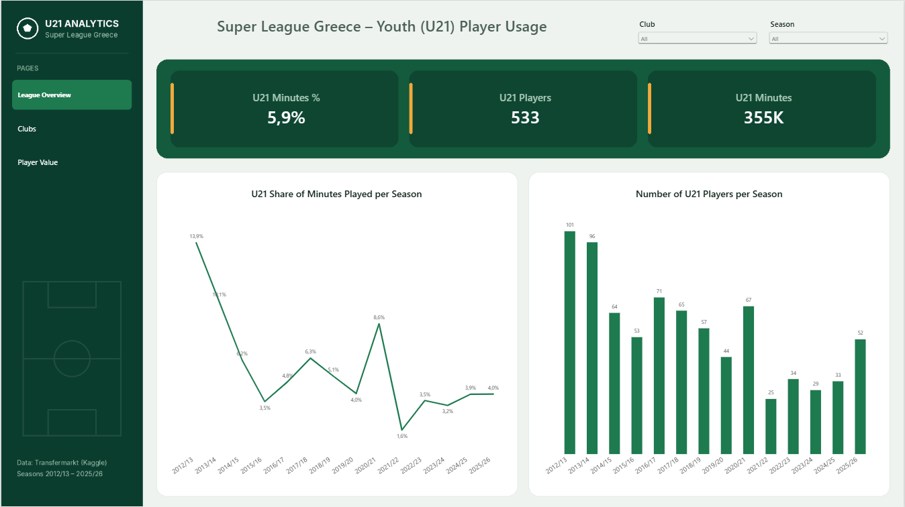
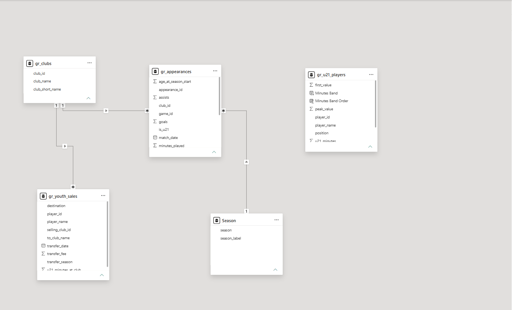
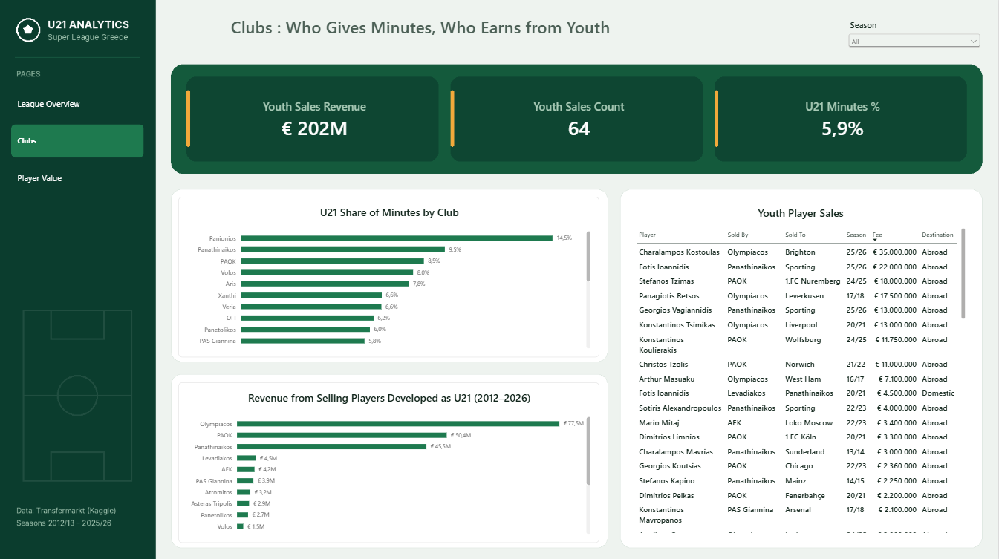
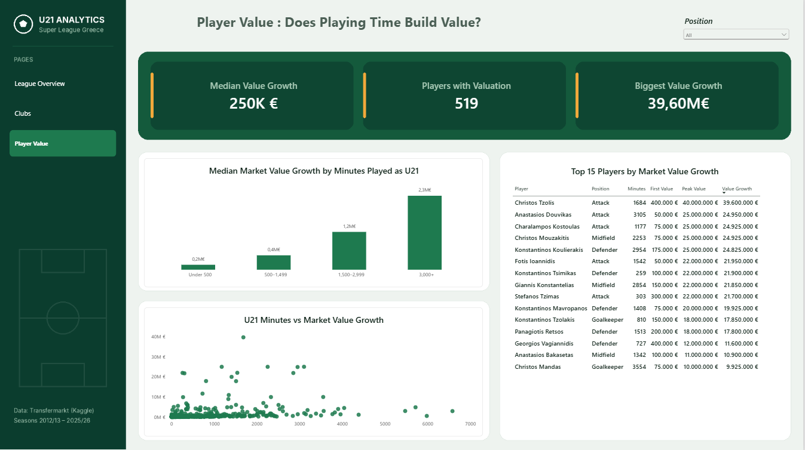

# Super League Greece – Youth (U21) Player Analysis

**Do Greek clubs give young players a chance, does playing time build market value, and who profits from it?**

An end to end analysis of 14 Super League Greece seasons (2012/13 – 2025/26) using **SQL Server** for data cleaning and analysis and **Power BI** for an interactive three-page dashboard.



---

## Table of Contents
- [Overview](#overview)
- [Dataset](#dataset)
- [Business Questions](#business-questions)
- [Tools](#tools)
- [Project Structure](#project-structure)
- [Data Cleaning & Preparation](#data-cleaning--preparation)
- [Data Model & DAX](#data-model--dax)
- [Key Insights](#key-insights)
- [Recommendations](#recommendations)
- [Limitations](#limitations)
- [Dashboard](#dashboard)


---

## Overview

At the Super League fixture draw in July 2026, the president of the Hellenic Football Federation stated that the league ranks **last in the use of U21 players** ([Ta Nea, 17/07/2026](https://www.tanea.gr/print/2026/07/17/sports/o-dromos-crpros-ton-titlo/)).

This project tests that claim with data. As a youth football coach (currently with the Greece U15 futsal pre-national team), I wanted to understand how young players progress in the Greek top flight: **who gets minutes, how that changes over time, whether those minutes translate into market value, and which clubs turn development into transfer revenue.**

---

## Dataset

**Source:** [Football Data from Transfermarkt](https://www.kaggle.com/datasets/davidcariboo/player-scores) (Kaggle, weekly updated)

7 of the 12 tables were used:

| Table | Rows | Used for |
|---|---|---|
| `competitions` | 65 | Identify Super League (`GR1`) |
| `clubs` | 796 | Club reference |
| `players` | 50,149 | Date of birth, position |
| `games` | 88,958 | Season of each match |
| `appearances` | 1,894,350 | Minutes, goals, assists per player per game |
| `player_valuations` | 656,301 | Market value history |
| `transfers` | 175,165 | Transfer fees and destinations |

**Scope:** Super League Greece, 14 seasons, **79,000+ player appearances**, **533 players** who played as U21.

**U21 definition:** a player is U21 if he was **under 21 on July 1st** of the season (standard definition in football analysis).

---

## Business Questions

1. **Which clubs give the most playing time to U21 players?** (share of total club minutes)
2. **How has U21 playing time in the league evolved per season?**
3. **Does playing time as U21 relate to market value growth?**
4. **Which clubs earn the most from selling players they developed as U21?**

---

## Tools

| Tool | Purpose |
|---|---|
| **SQL Server / SSMS** | Data import, cleaning, transformation, analysis (CTEs, window functions, `PERCENTILE_CONT`, `TRY_CAST`) |
| **Power BI Desktop** | Data model, DAX measures, interactive dashboard |
| **DAX** | Measures, calculated columns, context-aware filtering |

---

## Project Structure

```
super-league-youth-analysis/
├── README.md
├── sql/
│   └── super_league_youth_analysis.sql    # exploration, cleaning, analysis
├── powerbi/
│   ├── super_league_youth_dashboard.pbix
│   
└── images/
    ├── dashboard_overview.png
    ├── dashboard_clubs.png
    └── dashboard_player_value.png
```

---

## Data Cleaning & Preparation

All cleaning was done in SQL Server. The raw tables (`raw_*`) were kept untouched and clean tables (`gr_*`) were built from them.

**Import issues solved**
- **Integer overflow:** club IDs above 32,767 failed to load because the import wizard guessed `smallint`. All `smallint`/`tinyint` columns were changed to `int`.
- **Text truncation:** values like `4-3-3 Defending` were cut because the wizard sized text columns from the first rows only. Text columns were widened to `nvarchar(255)`.
- **Transfer fees ×1000:** fees stored as `13000000.000` were parsed with the decimal point as a thousands separator, turning €13M into €13 billion. The column was imported as text and converted safely with `TRY_CAST(... AS DECIMAL(18,2))`. *Caught by sanity-checking known transfers (Tsimikas to Liverpool ≈ €13M).*

**Quality checks**
- No duplicate appearances; no missing dates of birth for Super League players.
- Row counts verified at every join (no rows lost).
- Edge cases validated: youngest (15) and oldest (40) players checked against real players.

**Transformations**
- `gr_appearances`: Super League appearances with season label, exact age on July 1st and an `is_u21` flag.
- `gr_clubs`: most recent club name from Super League games, plus a short display name.
- `gr_u21_players`: one row per U21 player with minutes, first and peak market value, value growth.
- `gr_youth_sales`: paid transfers of players sold by the club where they played as U21, after their first U21 match there.

**Validation in Power BI**
Every dashboard KPI was compared with the SQL output. This revealed a naming bug: the pattern `LIKE '%Aris%'` also matched "L**aris**as", merging Aris and AEL Larissa into one club (and `'%Volou%'` merged Volos with Niki Volou). The mapping was fixed and a duplicate-name check was added to the script.

---

## Data Model & DAX



- **Fact:** `gr_appearances`
- **Dimensions:** `gr_clubs`, `Season` (calculated table)
- **Separate tables:** `gr_youth_sales` (linked to clubs), `gr_u21_players` (player-level, career totals)

**Key measures**

| Measure | Purpose |
|---|---|
| `U21 Minutes %` | U21 minutes ÷ total minutes |
| `U21 Players` | Distinct players aged U21 |
| `Youth Sales Revenue` / `Youth Sales Count` | Transfer income from developed players |
| `Median Value Growth` | Median of peak value − first value |
| `Players with Valuation` | Players with market value records |
| `Show In Club Ranking` | Hides clubs with fewer than 3 seasons in the all-time ranking, but shows all clubs when a single season is selected |

Calculated columns `Minutes Band` / `Minutes Band Order` group players by U21 minutes (Under 500, 500–1,499, 1,500–2,999, 3,000+).

---

## Key Insights

### 1. U21 playing time has collapsed
- U21 share of minutes fell from **13.9% (2012/13)** to **about 4%** in recent seasons, with a low of **1.6% in 2021/22**.
- The number of U21 players used dropped from **101** to **52** (2025/26).
- Because the league shrank from 18 to 14 teams, shares (not raw counts) were used for fair comparison. The decline holds.

### 2. The 2020/21 spike was league-wide and temporary
- U21 share jumped to **8.6%** in 2020/21, driven by **8+ clubs** at once (PAOK 0.7% → 15.8%, OFI 0.1% → 12.3%, Panetolikos 20.5%, Volos 19.2%, Panathinaikos 15.9%).
- It reversed the following season (Volos and OFI back to 0%). A season-specific factor is the likely explanation, probably **COVID-19 conditions** (five substitutions, congested schedule, financial pressure). This is a hypothesis, not a proven cause.

### 3. Who gives young players a chance
- **All-time (3+ seasons):** Panionios leads with **14.5%**, followed by Panathinaikos (9.5%), PAOK (8.5%), Volos (8.0%) and Aris (7.8%). Olympiacos (5.4%) and AEK (4.9%) trail; Lamia is last (0.6%).
- **2025/26:** OFI (12.5%) and **Olympiacos (10.1%)**, which nearly doubled its historical share.

### 4. Playing time is linked to value growth
| U21 minutes | Players | Median value growth |
|---|---|---|
| Under 500 | 314 | €150K |
| 500–1,499 | 126 | €438K |
| 1,500–2,999 | 60 | €1.15M |
| 3,000+ | 19 | €2.25M |

- The typical player with **3,000+ U21 minutes** grew his value about **15× more** than one with under 500.
- The median was used because a few outliers (Tzolis +€39.6M, Douvikas +€25M) inflate the average.
- But minutes alone don't make stars: players with **5,000+ minutes** show low growth, and Tsimikas or Tzimas rose with fewer than 310 Super League minutes.

### 5. The big three capture the revenue
- **64 paid sales, €202M** in total.
- **Olympiacos €77.5M**, **PAOK €50.4M**, **Panathinaikos €45.5M**: about **86%** of all revenue, almost entirely from sales abroad.
- Biggest sales: Kostoulas (€35M, Brighton), Ioannidis (€22M, Sporting), Tzimas (€18M, Nuremberg).
- **Minutes ≠ money:** Panionios leads in U21 minutes but earned only €0.55M.
- **Development chain:** Ioannidis was sold by Levadiakos to Panathinaikos for €4.5M and later to Sporting for €22M. The smaller club developed the player; the bigger club captured most of the value.

---

## Recommendations

- **For smaller clubs:** they already develop young players but rarely profit. Sell-on clauses in domestic transfers would let them share in the later value.
- **For development planning:** value growth rises clearly after **~1,500 U21 minutes** (roughly 17 full matches). This is a useful target for a loan or first-team pathway.
- **For the league:** the long-term decline supports the federation's concern. Incentives linked to U21 minutes could be evaluated, as other leagues have done.

---

## Limitations

- **Regular season only:** play-off games are not included in the dataset.
- **Market values** are Transfermarkt estimates, not official valuations, and peak value was often reached **after** leaving Greece.
- **Revenue is a lower bound:** transfers with undisclosed fees (`NULL`) were excluded; free transfers and loans (fee = 0) are not sales.
- **Correlation, not causation:** better players receive more minutes *and* reach higher values.
- The U21 cut-off on July 1st is a convention; other definitions would change the numbers slightly.

---

## Dashboard

**Page 1 – League Overview:** U21 share and number of U21 players per season, filterable by club and season.


**Page 2 – Clubs:** who gives minutes vs. who earns from youth, plus all youth player sales.


**Page 3 – Player Value:** median value growth by minutes band, minutes vs. value scatter, top 15 players.



---

**Author:** Georgios Tziouvelis · [LinkedIn](#) · [Other projects](#)
